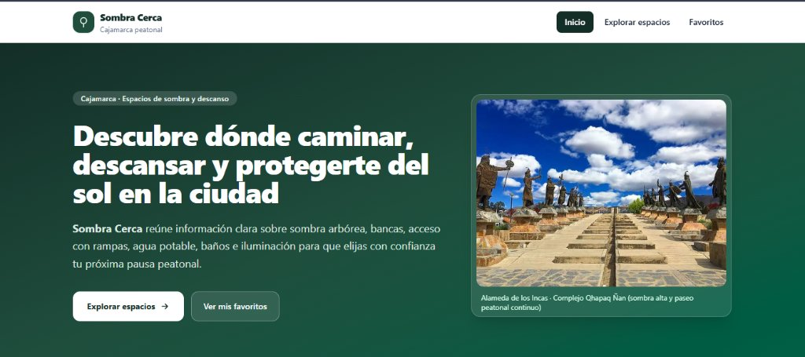
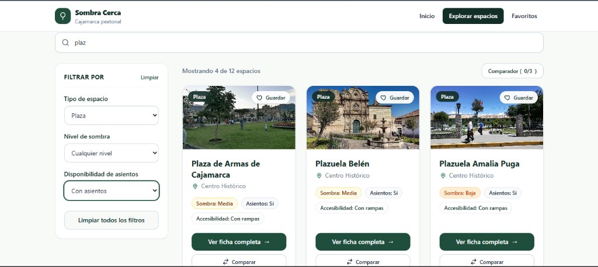
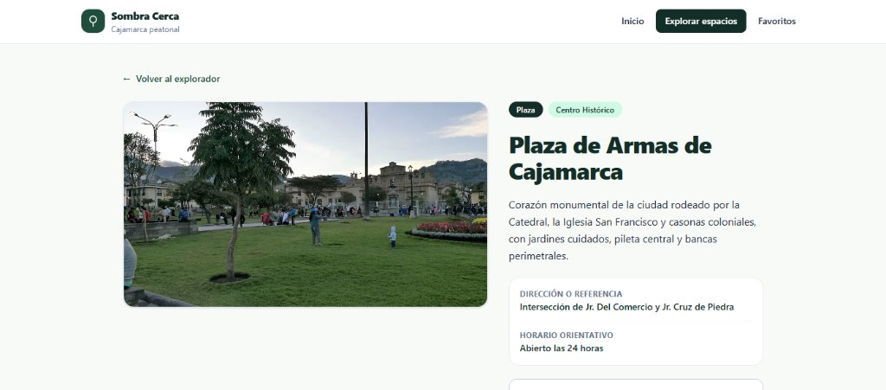
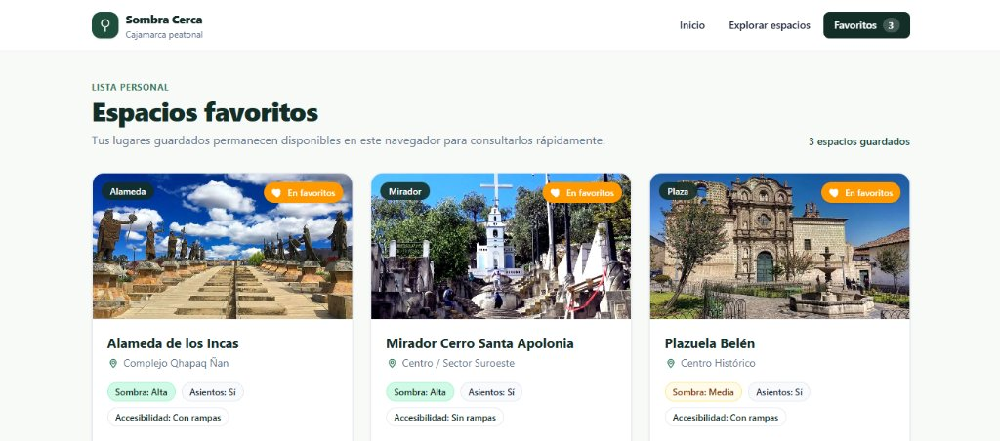
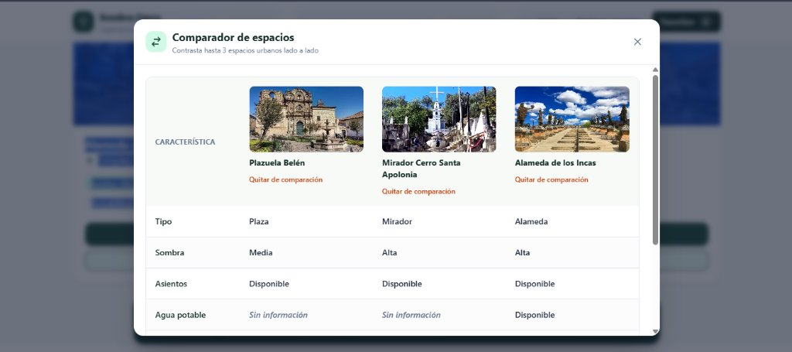

# Sombra Cerca

Guía web interactiva para descubrir dónde caminar, descansar y protegerse del sol en **Cajamarca, Perú**. Organiza información clave sobre sombra arbórea, bancas, agua potable, baños públicos, rampas e iluminación en parques, plazas, alamedas y miradores de la ciudad.

- **Demo en producción:** https://sombra-cerca.vercel.app/
- **Repositorio:** https://github.com/wigsdev/sombra-cerca
- **Versión:** `v1.0.0` (SemVer 2.0.0)

---

## Funcionalidades implementadas

- **Portada (`/`)**: propuesta de valor, acceso rápido al explorador, 3 espacios destacados y guía clara de indicadores de sombra, descanso y accesibilidad.
- **Explorador de espacios (`/espacios/`)**: catálogo de 12 espacios urbanos reales de Cajamarca en 4 categorías (`parque`, `plaza`, `alameda`, `mirador`) con búsqueda en tiempo real por nombre o zona (insensible a mayúsculas y acentos), filtros combinables (`tipo` + `sombra` + `asientos`), contador dinámico, acción de limpieza y estado sin coincidencias.
- **Ficha de detalle dinámica (`/espacios/[slug]/`)**: generación estática SSG con `getStaticPaths()`, descripción, dirección, horario orientativo, fotografía `.webp` optimizada y matriz separada de 6 indicadores. Todo dato sin confirmación en campo (`null`) se muestra explícitamente como **“Sin información”**.
- **Página 404 personalizada (`/404`)**: manejo diseñado de rutas o slugs inexistentes con retorno directo al catálogo.
- **Favoritos (`/favoritos/`)**: persistencia defensiva en `localStorage` (tolerante a almacenamiento vacío, bloqueado o JSON corrupto), sincronización de contador en la barra de navegación, eliminación directa desde tarjeta/ficha/lista y estado vacío con acceso al explorador.
- **Comparador de espacios**: selección de hasta **3 espacios** lado a lado (tipo, sombra, asientos, agua, baños, rampas e iluminación), bloqueo y aviso explicativo al intentar seleccionar un cuarto espacio, retiro individual y estado inicial vacío.

---

## Tecnologías y versiones

| Tecnología                          | Versión             | Uso en el proyecto                                                                      |
| :---------------------------------- | :------------------ | :-------------------------------------------------------------------------------------- |
| **Astro**                           | `^7.4.13`           | Estructura multipágina SSG, layouts, componentes y rutas dinámicas                      |
| **Tailwind CSS**                    | `^4.3.5`            | Sistema de diseño accesible, tokens `@theme` y diseño responsive (`375 px` – `1440 px`) |
| **pnpm**                            | `12.x`              | Gestión exclusiva de dependencias y scripts (`pnpm-lock.yaml`)                          |
| **Vanilla JavaScript**              | ESModules           | Modelo de datos, filtros combinados, persistencia defensiva y comparador                |
| **Vitest + Husky + GitHub Actions** | `^5.1.1` / `^9.1.7` | Pruebas unitarias automatizadas, hooks locales y CI en `main`                           |

---

## Requisitos previos

- **Node.js** `>= 22.23.4`
- **pnpm** instalado globalmente (`npm install -g pnpm` o `corepack enable`)

---

## Instalación y ejecución local

```bash
git clone https://github.com/wigsdev/sombra-cerca.git
cd sombra-cerca
pnpm install
pnpm dev
```

Abre `http://localhost:4321` en tu navegador. No se requieren variables de entorno ni pasos manuales adicionales.

### Comandos disponibles

```bash
pnpm dev         # Servidor de desarrollo local
pnpm test        # Pruebas unitarias con Vitest (datos, filtros, storage y comparador)
pnpm build       # Compilación de producción en dist/
pnpm preview     # Previsualización local del build de producción
```

---

## Estructura del proyecto

```text
src/
├── assets/icons/       # Íconos SVG nativos de Astro
├── components/
│   ├── common/         # Header.astro, Footer.astro
│   ├── comparador/     # ComparadorPanel.astro
│   └── espacios/       # CardEspacio.astro, MatrizServicios.astro
├── data/
│   └── espacios.js     # Fuente centralizada de 12 espacios y funciones reutilizables
├── layouts/
│   └── Layout.astro    # Layout HTML5 semántico base
├── pages/
│   ├── index.astro     # Portada (RF-01)
│   ├── espacios/
│   │   ├── index.astro # Explorador filtrable (RF-02)
│   │   └── [slug].astro# Ficha dinámica (RF-03)
│   ├── favoritos.astro # Lista de favoritos (RF-04)
│   └── 404.astro       # Página de error personalizada
├── scripts/            # Lógica cliente modular (filtros, storage, favoritos, comparador)
└── styles/
    └── global.css      # Tailwind CSS 4 y tokens de paleta accesible
public/images/espacios/ # 12 fotografías locales optimizadas en formato .webp
tests/                  # Pruebas unitarias Vitest (espacios, filtros, storage)
```

---

## Decisiones técnicas relevantes

1. **Fuente única de verdad (`src/data/espacios.js`):** Tanto la generación estática de Astro como el filtrado cliente reutilizan `filterSpaces()`, `findSpaceBySlug()` y `getFeaturedSpaces()`, evitando duplicación de fichas o inconsistencias.
2. **Integridad de datos (`null` vs `false`):** Los nombres, barrios y direcciones corresponden a espacios reales de Cajamarca; los atributos sin verificación en campo se modelan como `null` y se presentan como _“Sin información”_ en lugar de asumirse inexistentes.
3. **Cero frameworks cliente adicionales:** Toda la interactividad (filtros, favoritos y comparador) se resolvió con ESModules nativos, logrando un bundle mínimo y tiempos de carga rápidos.
4. **Persistencia defensiva en `localStorage`:** `src/scripts/storage.js` encapsula lectura y escritura con `try/catch`, validación de tipo `Array` y respaldo en memoria ante navegadores con almacenamiento bloqueado.
5. **Accesibilidad y rendimiento:** HTML semántico (`<header>`, `<nav>`, `<main>`, `<section>`, `<article>`, `<footer>`), foco visible por teclado (`focus-visible`), indicadores con texto + ícono (sin depender solo del color) y las 12 fotografías servidas localmente en `.webp`.

---

## Capturas de pantalla

### Portada


### Explorador con búsqueda y filtros combinados


### Ficha de detalle dinámica


### Lista de favoritos


### Comparador de hasta 3 espacios

