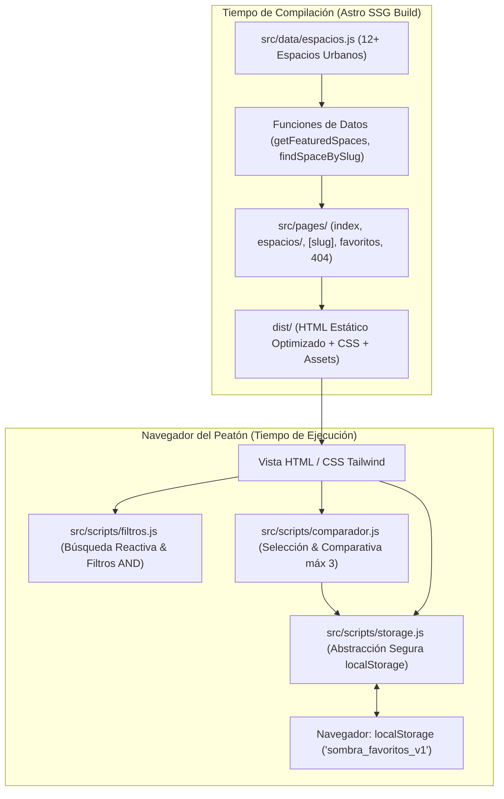

# Data & Technical Architecture · Sombra Cerca

> **Documento:** Arquitectura Técnica de Software y Modelo de Datos  
> **Rol asumido:** Frontend Software Architect & Data Specialist  
> **Proyecto de Referencia:** [docs/proyecto-individual-sombra-cerca.md](file:///home/wigsdev/GitHub/sombra-cerca/docs/proyecto-individual-sombra-cerca.md)  
> **Requerimientos Centrales:** Sección 5 (Modelo de datos obligatorio) · Sección 6 (Requerimientos técnicos) · RF-03 (Ficha dinámica) · RF-04 (Favoritos) · RF-05 (Comparador)

---

## 1. Arquitectura General del Sistema

Sombra Cerca está concebida como una aplicación frontend multipágina basada en **Astro 7.3** operando en modo de **Generación de Sitios Estáticos (SSG - Static Site Generation)** combinada con módulos de cliente en JavaScript moderno (*Vanilla JS / ESModules*) para reactividad en tiempo de ejecución.

### Diagrama de Flujo Arquitectónico



---

## 2. Contrato y Especificación del Modelo de Datos

Conforme a la Sección 5 de las especificaciones, todos los datos residen de forma centralizada en `src/data/espacios.js`. Queda estrictamente prohibida la duplicación manual de fichas o la dispersión de datos en componentes.

### 2.1 Esquema Tipado (TypeScript / JSDoc Contract)

```typescript
export interface EspacioUrbano {
  /** Identificador numérico único e inmutable */
  id: number;
  /** Cadena normalizada para la URL (kebab-case, minúsculas, sin acentos ni espacios) */
  slug: string;
  /** Nombre representativo del espacio urbano */
  nombre: string;
  /** Categoría obligatoria (mínimo 3 categorías distintas en el dataset) */
  tipo: 'parque' | 'plaza' | 'alameda' | 'mirador' | 'bosque_urbano';
  /** Sector, barrio o vecindario */
  zona: string;
  /** Dirección física o referencia geográfica conocida */
  direccion: string;
  /** Párrafo descriptivo detallando vegetación, sombra y atmósfera */
  descripcion: string;
  /** Ruta local interna (ej. /images/espacios/lugar.webp) o URL válida */
  imagen: string;
  /** Nivel de cobertura de sombra diurna */
  sombra: 'baja' | 'media' | 'alta';
  /** Disponibilidad de bancas o asientos: true (sí), false (no), null (sin información) */
  asientos: boolean | null;
  /** Punto de agua potable o bebedero: true (sí), false (no), null (sin información) */
  agua: boolean | null;
  /** Servicios higiénicos o baños públicos: true (sí), false (no), null (sin información) */
  banos: boolean | null;
  /** Rampas peatonales y accesibilidad motriz: true (sí), false (no), null (sin información) */
  rampas: boolean | null;
  /** Nivel de alumbrado público nocturno */
  iluminacion: 'baja' | 'media' | 'alta' | null;
  /** Horario orientativo conocido o referencial (campo complementario) */
  horario?: string;
}
```

### 2.2 Semántica Rigurosa del Valor `null` vs `false`
- **`true`:** La infraestructura fue comprobada o existe evidencia de que está disponible para el peatón.
- **`false`:** La infraestructura fue evaluada y se constató fehacientemente que **NO** existe (ej. parque sin baños públicos).
- **`null`:** No existen mediciones de campo o datos oficiales disponibles. **Regla de oro:** La aplicación jamás debe reemplazar `null` por `false`. En la interfaz debe presentarse visual y textualmente como:
  > *“Sin información”* (acompañado de icono neutral).

---

## 3. Dataset Inicial de Referencia (12 Espacios · Ciudad: Cajamarca)

Para asegurar la verosimilitud exigida en la Sección 1 y 2 del pliego, se estructura el catálogo con 12 espacios distribuidos en 4 categorías:

| ID | Slug | Nombre | Tipo | Zona | Sombra | Asientos | Agua | Baños | Rampas | Ilum. |
| :-: | :--- | :--- | :--- | :--- | :-: | :-: | :-: | :-: | :-: | :-: |
| **1** | `plaza-de-armas-cajamarca` | Plaza Mayor de Cajamarca | plaza | Centro Histórico | media | true | false | true | true | alta |
| **2** | `alameda-de-los-incas` | Alameda de los Incas | alameda | Qhapaq Ñan | alta | true | true | true | true | alta |
| **3** | `colina-santa-apolonia` | Mirador y Bosque Santa Apolonia | mirador | Sector Sur | alta | true | null | true | false | media |
| **4** | `parque-las-torrecitas` | Parque Las Torrecitas | parque | Barrio San Sebastián | alta | true | null | false | true | media |
| **5** | `plazuela-belen` | Plazuela del Complejo Belén | plaza | Centro Histórico | media | true | null | false | true | alta |
| **6** | `parque-el-estudiante` | Parque El Estudiante | parque | Barrio Chontapaccha | alta | true | false | false | true | media |
| **7** | `alameda-los-heroes` | Alameda Los Héroes | alameda | Av. Mario Urteaga | media | true | null | null | true | media |
| **8** | `bosque-urbano-parque-forestal`| Parque Forestal La Encañada | parque | Periferia Este | alta | false | null | false | false | baja |
| **9** | `plazuela-amalia-puga` | Plazuela Amalia Puga | plaza | Barrio San Pedro | baja | true | false | false | true | alta |
| **10**| `parque-ramon-castilla` | Parque Ramón Castilla | parque | Sector Pueblo Libre | media | true | null | null | true | media |
| **11**| `pasaje-peatonal-cultura` | Pasaje Cultural del Sol | alameda | Sector San José | alta | true | true | true | true | alta |
| **12**| `parque-ecologico-san-martin` | Parque Ecológico San Martín | parque | Barrio Mollepampa | alta | true | null | false | false | media |

*Nota de integridad (Sec. 2):* Se incluye una nota al pie en el catálogo indicando que los datos poseen carácter demostrativo y educativo para el reto académico.

---

## 4. Módulo de Lógica y Servicios de Datos (`src/data/espacios.js`)

Se provee un conjunto de funciones puras reutilizables en tiempo de compilación y exportables para el cliente:

```javascript
// src/data/espacios.js

export const ESPACIOS = [ /* ... 12 registros tipados ... */ ];

/**
 * Obtiene todos los espacios del catálogo.
 * @returns {Array<EspacioUrbano>}
 */
export function getAllSpaces() {
  return ESPACIOS;
}

/**
 * Busca un espacio por su slug único para la ruta dinámica /espacios/[slug].
 * @param {string} slug 
 * @returns {EspacioUrbano | undefined}
 */
export function findSpaceBySlug(slug) {
  if (!slug) return undefined;
  return ESPACIOS.find((espacio) => espacio.slug.toLowerCase() === slug.toLowerCase());
}

/**
 * Retorna los espacios destacados para la portada de inicio (RF-01).
 * @param {number} count Número de espacios requeridos (mínimo 3).
 * @returns {Array<EspacioUrbano>}
 */
export function getFeaturedSpaces(count = 3) {
  // Retorna espacios con sombra alta y asientos disponibles
  return ESPACIOS.filter((e) => e.sombra === 'alta' && e.asientos === true).slice(0, count);
}

/**
 * Filtra los espacios en memoria según criterios multidimensionales (RF-02).
 * @param {Object} filters
 * @param {string} [filters.query] Texto de búsqueda (nombre o zona)
 * @param {string} [filters.tipo] Categoría (todos o específica)
 * @param {string} [filters.sombra] Nivel de sombra (todos, baja, media, alta)
 * @param {boolean | null} [filters.asientos] Disponibilidad de asientos
 * @returns {Array<EspacioUrbano>}
 */
export function filterSpaces({ query = '', tipo = 'todos', sombra = 'todos', asientos = null }) {
  return ESPACIOS.filter((item) => {
    // 1. Coincidencia por texto en nombre o zona (insensible a acentos y mayúsculas)
    if (query.trim() !== '') {
      const q = query.toLowerCase().normalize("NFD").replace(/[\u0300-\u036f]/g, "");
      const matchName = item.nombre.toLowerCase().normalize("NFD").replace(/[\u0300-\u036f]/g, "").includes(q);
      const matchZone = item.zona.toLowerCase().normalize("NFD").replace(/[\u0300-\u036f]/g, "").includes(q);
      if (!matchName && !matchZone) return false;
    }
    // 2. Filtro de tipo
    if (tipo !== 'todos' && item.tipo !== tipo) return false;
    // 3. Filtro de sombra
    if (sombra !== 'todos' && item.sombra !== sombra) return false;
    // 4. Filtro de asientos
    if (asientos !== null && item.asientos !== asientos) return false;

    return true;
  });
}
```

---

## 5. Arquitectura de Persistencia Cliente (`localStorage`)

Para satisfacer **RF-04 (Favoritos)** y la selección de **RF-05 (Comparador)** sin dependencias externas:

### 5.1 Especificación del Almacenamiento Local
- **Clave de Favoritos:** `'sombra_cerca_favoritos_v1'`
- **Estructura almacenada:** Arreglo serializado en JSON con los IDs o Slugs numéricos/cadenas de los espacios:
  ```json
  ["plaza-de-armas-cajamarca", "alameda-de-los-incas"]
  ```
- **Clave del Comparador:** `'sombra_cerca_comparador_v1'`
- **Estructura almacenada:** Arreglo con un máximo estricto de 3 slugs:
  ```json
  ["alameda-de-los-incas", "colina-santa-apolonia"]
  ```

### 5.2 Estrategia Defensiva y Tolerancia a Fallos (`src/scripts/storage.js`)
El acceso a `window.localStorage` se encapsula dentro de un helper con bloques `try / catch`:
1. **Modo Incógnito / Quota Exceeded:** Si el navegador bloquea `localStorage` (como ocurre en navegadores estrictos con cookies bloqueadas), el helper conmuta automáticamente a almacenamiento en memoria volátil en `window.__memoryStorage` para evitar que la aplicación arroje errores en consola.
2. **JSON Corrupto:** Si el valor leído no es un JSON válido o no es un Array, el helper reinicia la clave con un arreglo vacío `[]` y continúa la ejecución normalmente.
3. **Sincronización Multiventana:** Escucha el evento `window.addEventListener('storage', ...)` para actualizar reactivamente la interfaz si el usuario agrega favoritos en otra pestaña del mismo navegador.

---

## 6. Generación de Rutas Dinámicas en Astro (`src/pages/espacios/[slug].astro`)

Conforme a Astro 7.3 en modo SSG, se utiliza la función obligatoria `getStaticPaths()`:

```astro
---
// src/pages/espacios/[slug].astro
import { getAllSpaces, findSpaceBySlug } from '../../data/espacios.js';
import Layout from '../../layouts/Layout.astro';
import MatrizServicios from '../../components/espacios/MatrizServicios.astro';

export async function getStaticPaths() {
  const espacios = getAllSpaces();
  return espacios.map((espacio) => ({
    params: { slug: espacio.slug },
    props: { espacio },
  }));
}

const { espacio } = Astro.props;

if (!espacio) {
  return Astro.redirect('/404');
}
---
<Layout title={`${espacio.nombre} · Sombra Cerca`}>
  <!-- Renderizado semántico de la ficha de detalle (RF-03) -->
</Layout>
```
