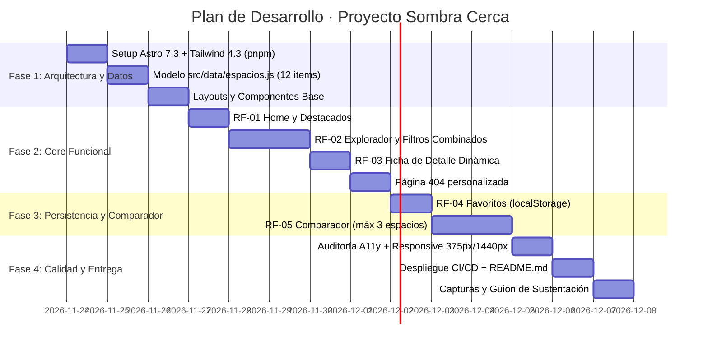

# Product Backlog · Sombra Cerca

> **Documento:** Backlog de Producto y Planificación Ágil  
> **Rol asumido:** Product Owner & Agile Project Manager  
> **Proyecto de Referencia:** [docs/proyecto-individual-sombra-cerca.md](file:///home/wigsdev/GitHub/sombra-cerca/docs/proyecto-individual-sombra-cerca.md)  
> **Stack Técnico:** Astro 7.3 · Tailwind CSS 4.3 · pnpm · Vanilla JavaScript · `localStorage`  
> **Meta de Evaluación:** 20 / 20 Puntos (Calificación Sobresaliente)

---

## 1. Visión del Producto y Objetivos Estratégicos

**Sombra Cerca** es un atlas interactivo de confort peatonal y refugios urbanos en la ciudad de Cajamarca (o urbe seleccionada). Su propósito es permitir a los transeúntes identificar con rapidez dónde caminar, descansar o protegerse del sol, consolidando información dispersa sobre arbolado, mobiliario de descanso, agua potable, higiene, rampas e iluminación nocturna.

### Definición de "Hecho" General (Definition of Done - DoD)
Una Historia de Usuario o Tarea Técnica se considera **Terminada (Done)** únicamente cuando:
1. Cumple al 100% sus criterios de aceptación en formato Gherkin (*Given-When-Then*).
2. Es completamente funcional en los tres breakpoints clave: Móvil (375 px, 1 columna), Tablet y Escritorio (1440 px, 2-3 columnas) sin desbordamiento horizontal accidental (`overflow-x`).
3. Cumple las pautas de accesibilidad básica (HTML semántico, textos `alt` informativos, navegación por teclado visible con `:focus-visible`, y no transmitir información crítica exclusivamente por color).
4. El código compila de forma limpia con `pnpm build` sin warnings ni errores de compilación.
5. Los datos provienen de la fuente centralizada `src/data/espacios.js`, respetando los tipos de datos y la convención `null` para datos no verificados.
6. El comportamiento dinámico (filtros, persistencia en `localStorage`, comparador) tolera estados vacíos o datos corruptos sin arrojar excepciones en consola.

---

## 2. Matriz de Trazabilidad con la Rúbrica de Evaluación (20 Puntos)

| Dimensión de la Rúbrica | Pts | Requerimientos Asociados | Épicas / Historias en Backlog |
| :--- | :---: | :--- | :--- |
| **Funcionalidad** | **7** | RF-01, RF-02, RF-03, RF-04, RF-05 | EPIC-01 (Catálogo y Búsqueda), EPIC-02 (Ficha Detalle), EPIC-03 (Favoritos), EPIC-04 (Comparador) |
| **Astro y Arquitectura** | **4** | Sec. 5, Sec. 6 (Estructura de Carpetas, Datos, Rutas Dinámicas) | TECH-01 (Setup Inicial), TECH-02 (Modelo Centralizado), TECH-03 (Routing y Layouts) |
| **Interfaz y Responsive** | **4** | RF-06, RF-09 | EPIC-05 (Diseño Responsivo e Identidad Visual) |
| **Calidad y Accesibilidad** | **2** | RF-07, RF-08, Manejo de `null` | TECH-04 (Accesibilidad A11y, Estados Vacíos y Manejo de Errores) |
| **Entrega y Sustentación** | **3** | Sec. 7 (Repo, README, Despliegue, Capturas, Presentación) | DELIV-01 (Documentación, Deploy y Demo) |
| **Desafíos Opcionales** | *Bono* | Sec. 10 (Mapa propio, Mejor coincidencia, Query params) | EPIC-06 (Desafíos de Innovación Frontend) |

---

## 3. Épicas e Historias de Usuario

---

### ÉPICA 01: Exploración y Catálogo Interactivo de Espacios Urbanos (RF-01, RF-02)

#### US-01: Portada y Presentación del Producto (RF-01)
* **Como** transeúnte o visitante en la ciudad,  
* **quiero** acceder a una página de inicio con la propuesta de valor, espacios destacados y una guía de indicadores,  
* **para** comprender de inmediato la utilidad del atlas y navegar rápidamente al catálogo de espacios.

* **Criterios de Aceptación (Gherkin):**
  * **Escenario 1: Hero y Llamada a la Acción (CTA)**
    * *Given* que el usuario visita la raíz del sitio `/`,
    * *When* carga la página de inicio,
    * *Then* visualiza el título del producto ("Sombra Cerca"), la propuesta de valor clara y un botón CTA principal que lo redirige a la ruta `/espacios/`.
  * **Escenario 2: Espacios destacados**
    * *Given* que el catálogo cuenta con al menos 12 espacios urbanos en `src/data/espacios.js`,
    * *When* se renderiza la sección de destacados,
    * *Then* se muestran al menos 3 tarjetas de espacios con su información resumida obtenidas mediante la función `getFeaturedSpaces()`.
  * **Escenario 3: Bloque pedagógico de indicadores**
    * *Given* que la aplicación utiliza indicadores de sombra, descanso y accesibilidad,
    * *When* el usuario desciende a la sección informativa,
    * *Then* visualiza una explicación clara de la iconografía y escalas (ej. sombra alta/media/baja, disponibilidad de asientos, rampas).

---

#### US-02: Explorador de Espacios con Filtros Combinados y Búsqueda Reactiva (RF-02)
* **Como** usuario que busca un sitio para descansar o protegerse del sol,  
* **quiero** filtrar los espacios urbanos por tipo, sombra y asientos mientras busco por nombre o zona,  
* **para** encontrar en segundos el lugar más adecuado a mis necesidades actuales.

* **Criterios de Aceptación (Gherkin):**
  * **Escenario 1: Listado inicial completo**
    * *Given* que el usuario ingresa a la ruta `/espacios/`,
    * *When* no se ha aplicado ningún filtro ni término de búsqueda,
    * *Then* se listan los 12 espacios mínimos existentes en la base de datos local, mostrando en cada tarjeta: fotografía, nombre, tipo, zona/barrio, nivel de sombra, disponibilidad de asientos y etiqueta de accesibilidad.
  * **Escenario 2: Búsqueda reactiva mientras se escribe (as-you-type)**
    * *Given* que el usuario está en el explorador,
    * *When* ingresa texto en el campo de búsqueda (ej. "Santa Apolonia" o "Centro"),
    * *Then* el catálogo filtra instantáneamente los espacios cuyo `nombre` o `zona` coincida (insensible a mayúsculas/minúsculas y acentos).
  * **Escenario 3: Filtrado multidimensional combinatorio**
    * *Given* que existen filtros por tipo (parque, plaza, etc.), nivel de sombra (baja, media, alta) y asientos (`true`/`false`),
    * *When* el usuario selecciona simultáneamente `tipo = parque`, `sombra = alta` y `asientos = true`,
    * *Then* la vista muestra exclusivamente aquellos registros que cumplan **todas** las condiciones de forma acumulativa (intersección lógica AND).
  * **Escenario 4: Conteo dinámico y estado vacío (Empty State)**
    * *Given* que el usuario aplica filtros muy restrictivos sin coincidencia,
    * *When* el resultado filtrado es 0,
    * *Then* el contador refleja "0 espacios encontrados" y se despliega un mensaje amigable indicando la ausencia de resultados junto a una acción para restablecer los filtros.
  * **Escenario 5: Limpieza total de filtros**
    * *Given* que se han seleccionado uno o varios filtros y texto de búsqueda,
    * *When* el usuario presiona el botón "Limpiar filtros",
    * *Then* todos los controles se reinician a su estado por defecto y se vuelve a desplegar la lista completa de espacios.

---

### ÉPICA 02: Ficha de Detalle Dinámica y Navegación (RF-03, RF-07)

#### US-03: Visualización Dinámica de Ficha de Espacio Urbano (RF-03)
* **Como** peatón interesado en un espacio específico,  
* **quiero** consultar su ficha individual con información completa y detallada de infraestructura,  
* **para** confirmar con certeza sus servicios antes de trasladarme físicamente.

* **Criterios de Aceptación (Gherkin):**
  * **Escenario 1: Renderizado por slug dinámico**
    * *Given* un slug válido registrado en los datos (ej. `/espacios/alameda-de-los-incas/`),
    * *When* el usuario navega a dicha ruta,
    * *Then* Astro resuelve dinámicamente la página renderizando: nombre, descripción extensa, dirección/referencia, horario orientativo, imagen principal/galería e indicadores completos.
  * **Escenario 2: Tratamiento estricto de valores desconocidos (`null`)**
    * *Given* que un atributo (ej. `banos` o `agua`) tiene valor `null` en la fuente de datos,
    * *When* se renderiza la lista de características,
    * *Then* la interfaz muestra textualmente la etiqueta “Sin información” acompañada de un icono neutro, evitando asumir que el servicio no existe (`false`).
  * **Escenario 3: Interacción de favoritos desde la ficha**
    * *Given* que el usuario está dentro de la ficha de detalle,
    * *When* presiona el botón "Guardar en favoritos",
    * *Then* el estado del botón cambia visualmente a "En favoritos", se actualiza `localStorage`, y al volver a presionarlo se retira de la lista.
  * **Escenario 4: Enlace de retorno**
    * *Given* que el usuario está en la ficha de detalle,
    * *When* pulsa "Volver al explorador",
    * *Then* es conducido de vuelta a `/espacios/`.

---

#### US-04: Gestión de Rutas Inexistentes y Error 404 (RF-03)
* **Como** usuario que ingresa una URL rota o un slug inexistente,  
* **quiero** visualizar una página de error 404 personalizada con la identidad de la aplicación,  
* **para** no quedar atrapado en una pantalla en blanco y poder regresar fácilmente al explorador.

* **Criterios de Aceptación (Gherkin):**
  * **Escenario 1: Navegación a slug inválido**
    * *Given* que un usuario ingresa a `/espacios/lugar-inexistente-xyz/`,
    * *When* el sistema procesa la solicitud,
    * *Then* responde con la página `404.astro` diseñada con la identidad visual del proyecto, explicando amigablemente el error y ofreciendo un botón directo hacia `/espacios/` y `/`.

---

### ÉPICA 03: Gestión y Persistencia de Favoritos (RF-04)

#### US-05: Almacenamiento y Consulta de Espacios Favoritos en Cliente (RF-04)
* **Como** usuario habitual,  
* **quiero** guardar mis espacios predilectos y consultarlos en una sección dedicada `/favoritos/`,  
* **para** tener a mano mis lugares habituales de descanso incluso tras cerrar o recargar el navegador.

* **Criterios de Aceptación (Gherkin):**
  * **Escenario 1: Persistencia local garantizada**
    * *Given* que el usuario añade 2 espacios a favoritos,
    * *When* recarga la página o cierra y reabre el navegador,
    * *Then* los 2 espacios continúan presentes en la página `/favoritos/` leídos directamente desde `localStorage`.
  * **Escenario 2: Retiro de favoritos**
    * *Given* que el usuario visualiza su lista en `/favoritos/`,
    * *When* presiona el botón "Quitar de favoritos" en una de las tarjetas,
    * *Then* el elemento desaparece inmediatamente de la vista y se elimina de `localStorage` sin necesidad de recargar la página.
  * **Escenario 3: Estado vacío resiliente**
    * *Given* que no hay espacios guardados o el usuario eliminó todos,
    * *When* visita `/favoritos/`,
    * *Then* visualiza una ilustración/icono representativo, un mensaje indicando que aún no cuenta con favoritos y un botón CTA "Explorar espacios" hacia `/espacios/`.
  * **Escenario 4: Manejo defensivo de excepciones**
    * *Given* que `localStorage` está bloqueado por políticas de privacidad o contiene un JSON corrupto,
    * *When* la aplicación inicializa la lógica de favoritos,
    * *Then* captura el error, inicializa una colección vacía segura en memoria y previene caídas de JavaScript en la consola.

---

### ÉPICA 04: Comparador de Atributos de Infraestructura Urbana (RF-05)

#### US-06: Comparación Técnica de Espacios Urbanos (RF-05)
* **Como** persona planificando un descanso o recorrido,  
* **quiero** comparar frente a frente hasta 3 espacios urbanos,  
* **para** discernir cuál posee mejores condiciones de sombra, accesibilidad y servicios complementarios.

* **Criterios de Aceptación (Gherkin):**
  * **Escenario 1: Selección progresiva para comparar**
    * *Given* que el usuario está en el catálogo o ficha,
    * *When* selecciona espacios para comparar (1, 2 o 3 elementos),
    * *Then* un panel o barra flotante refleja los espacios agregados y permite ver la tabla comparativa.
  * **Escenario 2: Comparación obligatoria de atributos mínimos**
    * *Given* que hay al menos 2 espacios en la comparación,
    * *When* se despliega la tabla comparativa,
    * *Then* se contrastan obligatoriamente fila por fila: Tipo, Sombra, Asientos, Agua potable, Baños públicos, Rampas e Iluminación.
  * **Escenario 3: Bloqueo estricto del 4to elemento**
    * *Given* que el usuario ya tiene 3 espacios seleccionados,
    * *When* intenta agregar un cuarto espacio,
    * *Then* el sistema bloquea la acción y emite un mensaje claro o notificación flotante explicando: "Solo puedes comparar un máximo de 3 espacios a la vez".
  * **Escenario 4: Remoción individual y estado inicial**
    * *Given* que hay elementos en comparación,
    * *When* el usuario pulsa el control para quitar un elemento,
    * *Then* este se elimina de la comparación. Si se eliminan todos, la vista vuelve a un estado introductorio invitando a seleccionar espacios.

---

### ÉPICA 05: Experiencia de Usuario, Accesibilidad y Diseño Responsivo (RF-06 a RF-09)

#### US-07: Adaptabilidad Responsiva Total (RF-06)
* **Como** peatón consultando el sitio desde mi teléfono móvil en la vía pública,  
* **quiero** una interfaz optimizada para pantallas estrechas (375 px) con controles táctiles cómodos,  
* **para** interactuar fluidamente sin desplazamientos horizontales accidentales.

* **Criterios de Aceptación:**
  * En móvil (<= 640 px / 375 px base), las tarjetas de espacios se distribuyen en una sola columna con jerarquía tipográfica legible.
  * En pantallas medianas y grandes (tablet / escritorio 1440 px), la cuadrícula pasa automáticamente a 2 o 3 columnas.
  * Los filtros en pantallas pequeñas se presentan en un panel colapsable o drawer accesible mediante un botón "Filtros".
  * Cero `overflow-x` en todas las pantallas.

#### US-08: Navegación Global y Estados de Interfaz (RF-07)
* **Como** usuario navegando por las secciones del sitio,  
* **quiero** una barra de navegación consistente con indicación visual de la página activa y estados interactivos claros,  
* **para** orientarme en todo momento y tener certeza de mis acciones.

* **Criterios de Aceptación:**
  * Barra de navegación semántica `<nav>` presente en todas las páginas con enlaces a: Inicio, Explorar espacios y Favoritos (con badge de cantidad si aplica).
  * La sección actual se marca con un estilo activo distintivo (`aria-current="page"`).
  * Todos los botones, enlaces y campos de formulario cuentan con estados visibles `:hover`, `:focus-visible` y `:active`.

#### US-09: Cumplimiento de Accesibilidad Web (RF-08)
* **Como** usuario con discapacidad visual o motriz,  
* **quiero** navegar mediante teclado y escuchar información estructurada con lector de pantalla,  
* **para** acceder a las mismas oportunidades de consulta y descanso que cualquier otro ciudadano.

* **Criterios de Aceptación:**
  * Estructura 100% semántica utilizando `<header>`, `<nav>`, `<main>`, `<section>`, `<article>` y `<footer>`.
  * Toda imagen informativa cuenta con un atributo `alt` descriptivo (ej. "Área arbolada con bancas de madera en Parque Santa Apolonia").
  * Contraste de color entre texto y fondo superior a ratio 4.5:1 (WCAG 2.1 Nivel AA).
  * Ningún indicador depende únicamente del color: todo nivel (sombra alta/media/baja, disponibilidad de rampas) incluye texto legible y/o icono representativo.
  * Todo control interactivo es operable con las teclas `Tab`, `Shift+Tab`, `Enter` y `Space`.

#### US-10: Identidad Visual Urbana y Natural (RF-09)
* **Como** usuario de la aplicación,  
* **quiero** disfrutar de una experiencia estética pulida inspirada en la sombra, vegetación y piedra urbana,  
* **para** sentir una conexión visual atractiva con el entorno de la ciudad alejándome de plantillas genéricas.

* **Criterios de Aceptación:**
  * Paleta de colores cohesionada basada en tonos verdes follaje, sombras esmeralda/bosque, neutros cálidos y acentos de luz solar.
  * Tipografía moderna, de alta legibilidad en exteriores.
  * Sistema visual coherente aplicado de manera uniforme en tarjetas, insignias, botones y modales.

---

### ÉPICA 06: Desafíos de Innovación Frontend (Opcionales · Sec. 10)

#### US-11: Mapa Esquemático Propio de Confort Peatonal
* **Como** usuario visual y geográfico,  
* **quiero** visualizar un mapa esquemático interactivo basado en SVG o Canvas propio (sin dependencias ni APIs externas de pago),  
* **para** ubicar espacialmente los refugios urbanos en Cajamarca y hacer clic en ellos para ver su detalle.

#### US-12: Algoritmo de "Mejor Coincidencia" Peatonal
* **Como** peatón con necesidades específicas,  
* **quiero** recibir recomendaciones con un sello de "Mejor Coincidencia" según mis filtros activos,  
* **para** identificar de inmediato el espacio óptimo con explicación del criterio de puntuación.

#### US-13: URLs Compartibles con Parámetros de Filtro
* **Como** usuario que desea recomendar un espacio o vista filtrada a un amigo,  
* **quiero** que los filtros aplicados se sincronicen en los query parameters (`?tipo=parque&sombra=alta`),  
* **para** compartir el enlace directo manteniendo el estado exacto de visualización.

---

## 4. Tareas Técnicas y Habilitadores de Arquitectura (TECH)

| ID | Nombre de Tarea Técnica | Entregable / Evidencia |
| :--- | :--- | :--- |
| **TECH-01** | Inicialización limpia de Astro 7.3, Tailwind CSS 4.3 y pnpm | Repositorio estructurado sin `package-lock.json` ni `yarn.lock`. |
| **TECH-02** | Implementación del modelo `src/data/espacios.js` con 12 espacios reales/verosímiles | Archivo centralizado con validación de tipos, slugs únicos y funciones de consulta. |
| **TECH-03** | Configuración del Layout Principal y Sistema de Componentes Reutilizables | Layout base, Header semántico, Footer, Card, Badge, FilterGroup. |
| **TECH-04** | Arquitectura del Store Cliente para Favoritos y Comparador | Módulos JavaScript cliente en `src/scripts/` con persistencia segura en `localStorage`. |
| **TECH-05** | Configuración de página de error 404 personalizada | Archivo `src/pages/404.astro` respetando el sistema de diseño. |
| **TECH-06** | Auditoría y optimización de rendimiento y accesibilidad (Lighthouse) | Puntuación de Performance, A11y y Best Practices > 95%. |

---

## 5. Planificación de Fases de Desarrollo

---

## 6. Checklist de Validación previa al Cierre del Sprint

- [ ] ¿Están implementados los 12 espacios mínimos con fotografías reales/licenciadas?
- [ ] ¿Los filtros de Tipo + Sombra + Asientos se combinan en intersección lógica perfecta?
- [ ] ¿Los valores `null` muestran inequívocamente “Sin información”?
- [ ] ¿El comparador bloquea rígidamente al intentar agregar un 4to espacio?
- [ ] ¿Los favoritos sobreviven al refresco F5 en el navegador?
- [ ] ¿La compilación `pnpm build` finaliza en 0 errores y 0 warnings?
